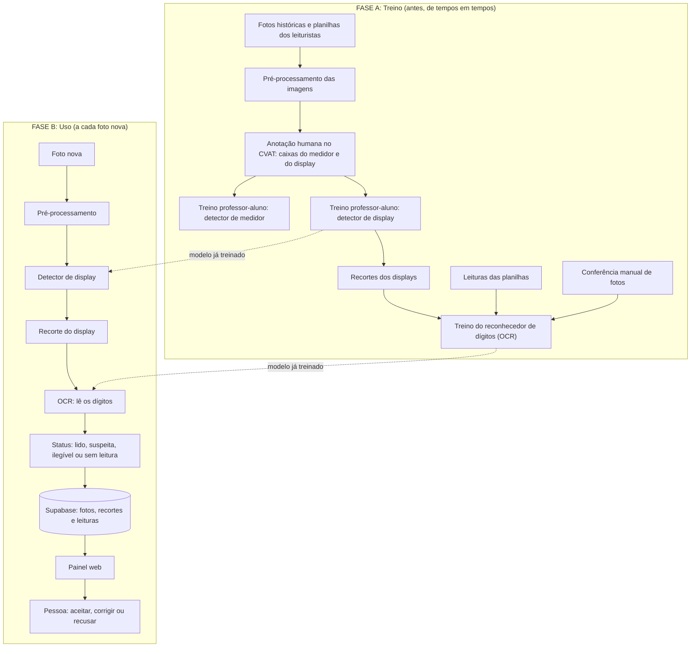
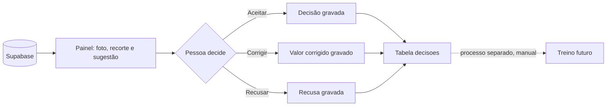

# VoltLens: leitura de medidores de energia por foto

O VoltLens é um sistema de visão computacional que **lê o número de medidores de energia a partir das fotos tiradas pelos leituristas**. Ele localiza o display do medidor na foto, recorta essa região, interpreta os dígitos e diz quão confiável é aquela leitura. Uma pessoa então confere o resultado num painel web.

> **Em uma frase:** o computador faz o trabalho repetitivo de olhar a foto e sugerir o número, e a pessoa só valida, corrige ou recusa a sugestão.

Este documento foi escrito para quem **não é da área técnica**. As primeiras seções explicam o projeto com palavras simples; as últimas trazem os comandos para quem vai rodar ou treinar o sistema.

## Sumário

1. [O problema e a ideia](#1-o-problema-e-a-ideia)
2. [Visão geral em um desenho](#2-visão-geral-em-um-desenho)
3. [Conceitos básicos, sem jargão](#3-conceitos-básicos-sem-jargão)
4. [Os dados do projeto](#4-os-dados-do-projeto)
5. [Fase A: como os modelos aprendem (treino)](#5-fase-a-como-os-modelos-aprendem-treino)
6. [Fase B: o caminho de uma foto nova](#6-fase-b-o-caminho-de-uma-foto-nova)
7. [O painel e o Supabase](#7-o-painel-e-o-supabase)
8. [Resultados e limitações, com honestidade](#8-resultados-e-limitações-com-honestidade)
9. [Como rodar a demonstração de ponta a ponta](#9-como-rodar-a-demonstração-de-ponta-a-ponta)
10. [Como treinar os modelos (referência técnica)](#10-como-treinar-os-modelos-referência-técnica)
11. [Mapa do repositório](#11-mapa-do-repositório)
12. [Configuração central](#12-configuração-central)
13. [Problemas comuns](#13-problemas-comuns)
14. [Perguntas frequentes](#14-perguntas-frequentes)
15. [Glossário](#15-glossário)

---

## 1. O problema e a ideia

### O problema

Leituristas percorrem os imóveis, fotografam o medidor de cada um e registram o valor lido. Depois, alguém precisa conferir se o número registrado bate com a foto. Com milhares de fotos por lote, esse trabalho é lento e sujeito a erro. As próprias planilhas dos leituristas têm erros: na conferência manual de uma amostra, cerca de **16% das fotos legíveis** tinham no CSV um valor diferente do que aparece no display.

### A ideia

O VoltLens divide o trabalho em três passos, como uma pessoa faria:

1. **Achar** onde está o display (a janelinha com os números) na foto.
2. **Ler** os dígitos que aparecem ali.
3. **Avaliar** se a leitura merece confiança ou se precisa de um olhar humano.

Os passos 1 e 2 são feitos por modelos de inteligência artificial. O passo 3 combina a confiança do modelo com regras simples. Depois disso, uma pessoa valida no painel.

### O que o VoltLens faz e o que não faz

| Faz | Não faz |
|---|---|
| Sugere a leitura de cada foto, com um grau de confiança. | Garantir que a leitura está certa. Mesmo uma leitura de alta confiança é uma previsão. |
| Separa as fotos em quatro status: `lido`, `leitura_suspeita`, `ilegivel` e `sem_leitura`. | Ler fotos muito escuras, borradas ou com reflexo forte. Nesses casos ele diz que não conseguiu. |
| Guarda as decisões das pessoas no painel. | **Aprender sozinho com as correções.** Retreinar os modelos é um processo separado e manual. |

## 2. Visão geral em um desenho

O projeto tem **duas fases bem diferentes**. É a ideia mais importante para entender o resto.



Se o desenho não aparecer no seu visualizador, a versão em texto é esta:

```text
FASE A (treino)
  fotos históricas ─► pré-processamento ─► anotação humana (CVAT)
        ├─► treino do detector de medidor  (professor-aluno)
        └─► treino do detector de display  (professor-aluno) ─► recortes
                                                                  │
          leituras das planilhas + conferência manual ────────────┴─► treino do OCR

FASE B (uso, a cada foto nova)
  foto ─► pré-processamento ─► detector de display ─► recorte ─► OCR ─► status
                                                                         │
                          painel web ◄── Supabase ◄──────────────────────┘
                          (aceitar / corrigir / recusar)
```

| | Fase A: treinar | Fase B: usar |
|---|---|---|
| **O que acontece** | Os modelos aprendem com exemplos. | Os modelos já prontos são aplicados a fotos novas. |
| **Quando** | Antes de usar, e de novo se quiser melhorar. | Toda vez que chegam fotos novas. |
| **Quem precisa** | Quem desenvolve o sistema. | Quem opera e valida. |
| **Demora** | Bem mais lenta que o uso; placa de vídeo (GPU) é recomendada. | 1 a 3 minutos para as 18 fotos de teste. |

> **A correção feita no painel NÃO retreina os modelos automaticamente.** As decisões ficam registradas e podem ser reaproveitadas num treino futuro, mas isso é feito à parte, de propósito.

## 3. Conceitos básicos, sem jargão

Uma analogia ajuda: imagine ensinar uma pessoa nova a ler medidores.

| Termo | Em palavras simples | Analogia |
|---|---|---|
| **Modelo** | Um programa que aprendeu um padrão a partir de exemplos. | A "experiência" da pessoa nova. |
| **Treinar** | Mostrar muitos exemplos com a resposta certa para o modelo aprender. | Mostrar centenas de fotos já corrigidas. |
| **Inferir** | Usar o modelo já treinado numa foto nova. | A pessoa trabalhando sozinha, depois de treinada. |
| **Checkpoint** | O arquivo (`.pt`) que guarda o que o modelo aprendeu. | O caderno de anotações da pessoa. |
| **Detector** | Modelo que acha um objeto na imagem e desenha uma caixa em volta. | Apontar "o display está aqui". |
| **Caixa (bounding box)** | O retângulo que marca onde o objeto está. | Um marca-texto em volta do display. |
| **OCR** | Transformar o texto que aparece numa imagem em caracteres. | Ler os números do display. |
| **Confiança** | O quanto o modelo "acha" que acertou, de 0 a 1. | "Tenho 95% de certeza". |
| **Pseudo-rótulo** | Uma anotação feita pelo próprio modelo, não por uma pessoa. | A pessoa nova corrigindo provas, com a chance de se enganar. |
| **Professor e aluno** | Dois papéis durante o treino: o professor rotula, o aluno aprende com esses rótulos. | O aluno que só vira professor se tirar nota maior. |

O glossário completo está [no fim do documento](#15-glossário).

## 4. Os dados do projeto

O sistema usa cinco tipos de informação.

| Dado | O que é | Onde fica |
|---|---|---|
| **Fotos dos medidores** | As imagens originais tiradas em campo, em lotes (`PSP_EXTRATLEITIMPL_...`). | `data/raw_images/<lote>/` |
| **Fotos pré-processadas** | As mesmas fotos, com brilho e nitidez ajustados. | `data/preprocessed_images/` |
| **Anotações de localização** | Caixas desenhadas por pessoas em volta do medidor e do display. Formato COCO, exportado do CVAT. | `data/annotations/` |
| **Planilhas dos leituristas (CSV)** | A leitura que o leiturista digitou e o registro do PDA, por foto. | `data/sheets/` |
| **Fotos conferidas à mão** | Fotos em que alguém informou a leitura correta ou marcou "ilegível". | `data/review/` |

Três cuidados:

- Só **um dos quatro lotes** (`PSP_EXTRATLEITIMPL_030726_0121`, 2.992 imagens) tem anotação humana. Os outros três (9.348 imagens) não, e é aí que entra o treino professor-aluno.
- Quase tudo em `data/` fica **fora do git**, porque são fotos e planilhas do cliente. A exceção é `data/imgs_raw_test/`, com 18 fotos de teste.
- O CSV do leiturista é um **rótulo com ruído**: serve para treinar, mas não é a verdade absoluta.

---

## 5. Fase A: como os modelos aprendem (treino)

### 5.1 Pré-processamento: arrumar a foto antes de usar

Nem toda foto chega em boas condições. O programa mede **brilho** e **nitidez** de cada imagem e aplica um ajuste quando precisa:

| O que ele detecta | Valor padrão | O que faz |
|---|---|---|
| Foto escura | brilho médio abaixo de 60 | Clareia. |
| Foto clara demais | brilho médio acima de 200 | Escurece. |
| Foto borrada | nitidez abaixo de 70 | Aplica um filtro de nitidez. |
| Foto com ruído | nitidez acima de 130 | Aplica uma suavização. |

O objetivo não é inventar informação, e sim deixar a imagem mais fácil para os modelos. As fotos originais **não são alteradas**: o resultado vai para outra pasta. O script (`pipelines/preprocessing_images.py`) processa arquivos `.jpg` e `.jpeg`.

### 5.2 Anotação humana: ensinar onde está o objeto

Para um detector aprender, alguém precisa mostrar onde o medidor e o display estão. Isso é feito no **CVAT**, uma ferramenta externa de anotação:

1. As fotos de um lote são carregadas numa tarefa do CVAT.
2. Uma pessoa desenha uma caixa em volta do medidor (classe `Medidor`) ou do display (classe `Display`).
3. A tarefa é exportada no formato **COCO**, um JSON com a lista de imagens, de caixas e de categorias. A caixa é escrita como `[x, y, largura, altura]`.

Fotos **sem caixa** viram **exemplos negativos** ("aqui não há medidor identificável", como fachadas, portas ou fotos ilegíveis). Isso ensina o modelo a não inventar uma detecção quando não há nada. O parâmetro `max_image_id` impede que fotos ainda não anotadas sejam tratadas como negativas por engano.

### 5.3 Os detectores: Faster R-CNN

Os dois detectores usam a mesma arquitetura, a **Faster R-CNN com ResNet50-FPN v2**, e são **modelos separados**, com arquivos próprios:

| Detector | Procura | Checkpoint |
|---|---|---|
| **Detector de medidor** | O medidor inteiro. | `models/checkpoints/semi_supervised/best.pt` |
| **Detector de display** | A janela com os dígitos. | `models/checkpoints/display/best.pt` |

Em vez de começar do zero, o projeto parte de um modelo que já aprendeu a reconhecer objetos do dia a dia num grande conjunto de fotos públicas (COCO). Esse conhecimento é aproveitado, e só a última camada é trocada para reconhecer a nossa classe. Isso se chama **transfer learning** e funciona bem com poucos exemplos próprios.

### 5.4 Treino professor-aluno (semi-supervisionado)

Anotar fotos à mão é caro, e só um lote tem anotação. Para aproveitar as fotos sem anotação, o projeto usa o treino **professor-aluno**, também chamado de *self-training* ou *Noisy Student*.

```text
Rótulos humanos ──► PROFESSOR (rodada 0)
                        │  olha as fotos sem anotação (também espelhadas)
                        ▼
        Fotos sem anotação ──► aceito | negativo | revisar
                        │
Rótulos humanos + pseudo-rótulos aceitos ──► ALUNO novo (com augmentação forte)
                        │  só vira professor se melhorar na validação
                        ▼
               próxima rodada ... ──► best.pt
```

**Passo a passo:**

1. O **professor** é treinado só com as fotos anotadas por pessoas.
2. Ele analisa as fotos sem anotação e propõe caixas. Essas propostas são os **pseudo-rótulos**.
3. Cada foto recebe um destes status, conforme a confiança:

| Status | Regra | O que acontece |
|---|---|---|
| `aceito` | Todas as caixas com confiança de **0,80 ou mais**. | Entra no treino do aluno com as caixas propostas. |
| `negativo` | Nenhuma caixa passa de **0,05**. | Entra como "sem medidor". |
| `revisar` | Alguma caixa na zona de dúvida. | **Fica fora do treino** e vai para revisão humana. Tratá-la como certeza ensinaria o erro. |

4. Um **aluno novo** é treinado com uma mistura de, em média, **metade rótulos humanos e metade pseudo-rótulos**, para que os pseudo-rótulos não dominem. O treino usa *augmentação forte*: pequenas rotações, deslocamentos, mudanças de brilho e contraste e desfoque, para o aluno aprender com variações.
5. O aluno é avaliado num conjunto de **validação anotado só por humanos**, que nunca recebe pseudo-rótulos. **Se o aluno for melhor, ele vira o professor** da rodada seguinte. Se não for, o processo para e o melhor modelo é mantido.

**Detalhes que melhoram a qualidade:**

- **TTA (espelhamento).** Na hora de gerar pseudo-rótulos, o modelo olha a foto original e a espelhada. Uma caixa vista nas duas tem a confiança média; vista em só uma, tem a confiança pela metade. Isso derruba palpites instáveis.
- **Caixas aninhadas.** O modelo às vezes marca o medidor e também o gabinete que o contém. Se 80% ou mais de uma caixa está dentro de outra de confiança maior, ela é descartada.
- **Validação separada.** Mesma ordem, semente e proporção do detector antigo (553 imagens com caixa, mais 20% das negativas), para comparar com justiça.

O resultado registrado do detector de medidor é **AP50:95 = 0,625** (0,6206 sem TTA), e o melhor modelo veio da rodada 2 (época 11). O mesmo processo, com a seção `display_detector`, treina o detector de display.

### 5.5 Recortes de display

Com o detector de display treinado, roda-se o `crop_detector.py` sobre as fotos de cada lote. Para cada foto ele:

1. Pega a caixa de maior confiança (se passar do limiar).
2. Adiciona uma **margem** (10% por padrão) para não cortar dígitos na borda.
3. Recorta a região da foto **original colorida** (por isso existe o parâmetro `--crop-source`).
4. Grava um `manifest.csv` com uma linha por foto.

Cada recorte recebe um status:

| Status do recorte | Significado | Gera recorte? |
|---|---|---|
| `recortado` | Caixa válida e inteira dentro da foto. | Sim |
| `caixa_cortada` | Mais de 15% da caixa ficou fora da foto. | Sim, mas fica marcado |
| `sem_deteccao` | Confiança abaixo do limiar. | Não |
| `caixa_invalida` | Caixa pequena demais para ler. | Não |

### 5.6 O reconhecedor de dígitos (OCR)

O reconhecedor (`MeterReader`) é uma rede **CNN + BiLSTM**, criada para este projeto e treinada do zero (sem pesos pré-treinados). Em termos simples:

- A **CNN** olha a imagem do display e aprende os traços de cada dígito.
- A **BiLSTM** lê a faixa da esquerda para a direita e da direita para a esquerda, para entender a sequência.
- A saída são **6 posições fixas**, cada uma com uma escolha entre 0 e 9.

**Zeros à esquerda.** O display mostra zeros à esquerda (`004939`), mas o CSV traz só `4939`. O projeto completa o rótulo com zeros, e assim os zeros viram rótulo de verdade, em vez de algo a ignorar. Na hora de mostrar o resultado, os zeros à esquerda são removidos.

**Por que não CTC?** O projeto testou uma técnica comum de OCR (CTC), mas, com rótulos sem zeros à esquerda, a rede ficou presa por dezenas de épocas só respondendo "vazio". Com as 6 posições fixas, o mesmo conjunto aprende em cerca de 20 épocas.

**Confiança da leitura.** É a **menor probabilidade entre as 6 posições**: basta um dígito duvidoso para a leitura inteira ser considerada duvidosa.

**Saída de "ilegível".** Uma segunda saída estima a probabilidade de o display estar ilegível (borrado, escuro, com reflexo). Ela só aprende com as **fotos conferidas à mão**, porque o CSV não diz se a foto era legível. Fotos marcadas como ilegíveis ensinam essa saída e ficam fora do aprendizado dos dígitos. Há um detalhe técnico (`detach`): essa saída só "lê" o que os dígitos já aprenderam, sem influenciar o aprendizado deles. Sem isso, os dígitos não saíam do ponto de partida.

**Treino.** As fotos são divididas em 80% treino, 10% validação e 10% teste. Recortes com confiança de detecção abaixo de 0,5 ficam de fora (caixa duvidosa). As fotos de treino conferidas à mão trocam a leitura do CSV pela leitura conferida, e **entram 3 vezes por época** (`review_repeat`), porque um rótulo limpo vale mais que o do CSV.

### 5.7 Conferência manual

Para medir de verdade o quanto o modelo acerta, é preciso comparar com algo mais confiável que o CSV. Por isso existe a **conferência manual**:

1. `utils/build_review_page.py` gera uma página HTML com fotos para alguém conferir.
2. A pessoa digita a leitura que **vê** na foto, ou marca **"ilegível"**.
3. Ela exporta um CSV pelo botão da página.

Existem dois usos, que **não podem se misturar**:

| Conjunto | Para que serve | Arquivo |
|---|---|---|
| **Teste** (200 fotos) | Medir o modelo. | `data/review/review.csv` |
| **Treino** (1.000 fotos) | Melhorar o modelo. | `data/review/review_train_NN.csv` |

Conferir fotos de teste e depois treinar com elas invalidaria a medida, como dar a prova ao aluno antes do exame. Nas 1.000 fotos de treino conferidas, **47% eram ilegíveis**.

---

## 6. Fase B: o caminho de uma foto nova

É o que acontece quando chegam fotos novas. Os modelos **já estão treinados**; nada é aprendido aqui.

| # | Etapa | O que acontece | Script |
|---|---|---|---|
| 0 | **Chegada** | A foto é baixada do Supabase (ou lida de uma pasta). | `scripts/ponta_a_ponta.py` |
| 1 | **Pré-processamento** | Ajuste de brilho e nitidez. | `pipelines/preprocessing_images.py` |
| 2 | **Localizar o display** | O detector de display desenha a caixa. | `pipelines/crop_detector.py` |
| 3 | **Recortar** | Só a região do display é cortada, com margem. | `pipelines/crop_detector.py` |
| 4 | **Ler os dígitos** | O reconhecedor devolve leitura, confiança e probabilidade de "ilegível". | `pipelines/read_meter.py` |
| 5 | **Dar um status** | Regras simples combinam confiança e legibilidade. | `src/meter_reading.py` |
| 6 | **Publicar** | Fotos, recortes e leituras vão para o Supabase. | `scripts/supabase_carregar.py` |
| 7 | **Revisão humana** | A pessoa abre o painel e decide. | `frontend/` |

### Uma foto, de ponta a ponta (exemplo ilustrativo)

1. Chega a foto `IMG_0421.jpg`, um pouco escura.
2. O pré-processamento clareia a imagem.
3. O detector de display marca uma caixa com confiança 0,93.
4. O sistema recorta o display, com 10% de margem.
5. O reconhecedor lê `004939`, com confiança 0,97 e probabilidade de ilegível 0,04.
6. Como a confiança é maior ou igual a 0,9 e a probabilidade de ilegível é menor que 0,5, o status é **`lido`**, com leitura **4939**.
7. A foto, o recorte e a leitura são publicados no Supabase.
8. No painel, a pessoa vê a foto original, o recorte e a sugestão **4939**, e clica em *Aceitar*.

Se o display estivesse borrado, o status provavelmente seria `ilegivel` e o sistema pediria outra foto. Se o detector não achasse o display, seria `sem_leitura`.

### Os quatro status

| Status | Quando acontece | O que fazer |
|---|---|---|
| **`lido`** | Confiança **maior ou igual a 0,9** e a foto não parece ilegível. | Pode ser aceito automaticamente. |
| **`leitura_suspeita`** | Há leitura, mas a confiança ficou abaixo de 0,9. | Conferência humana. |
| **`ilegivel`** | A probabilidade de o display estar ilegível é **maior ou igual a 0,5**. | Pedir uma nova foto. |
| **`sem_leitura`** | O detector não achou o display (ou a caixa era pequena demais para ler). | Revisar a foto ou pedir outra. |

A ordem das regras importa: primeiro se verifica se há leitura, depois se a foto é ilegível e só então a confiança. Os valores 0,9 e 0,5 são **parâmetros** (`accept_confidence` e `max_illegible_prob`), não leis da natureza.

> **Um limite mais alto aceita menos fotos, mas erra menos entre as aceitas.** É uma troca entre cobertura e qualidade, e a tabela da [seção 8](#8-resultados-e-limitações-com-honestidade) mostra os números.

O resultado de cada lote fica em `readings.csv`, com as colunas `image`, `crop_status`, `detection_score`, `status`, `reading`, `confidence` e `illegible_prob`.

---

## 7. O painel e o Supabase

### Supabase: a parte online

O **Supabase** é o serviço que guarda os dados e deixa o painel acessá-los de qualquer computador.

| Tabela | O que guarda |
|---|---|
| `lotes` | Um lote por pasta de `data/readings/`. |
| `leituras` | Uma linha por foto: sugestão do OCR, registro do leiturista (PDA), gabarito conferido e caminho da foto. |
| `decisoes` | Aceitar, corrigir ou recusar, de cada pessoa. **Cada um só vê as próprias decisões.** |
| `questionarios` | As três perguntas do fim do lote. |

As **fotos e os recortes** ficam no bucket privado `leituras` (Storage), organizados em `<lote>/fotos/` e `<lote>/recortes/`. O painel só os mostra por **links assinados, válidos por uma hora, para quem está logado**. As fotos nunca ficam abertas ao público.

### O painel web

O painel (React + Vite + TypeScript, na pasta `frontend/`) é onde as pessoas validam as leituras.

- **Login:** só entra quem tem conta. A tela pede "Usuário" e "Senha"; por trás, `maria` vira o e-mail `maria@voltlens.local`.
- **Fila por lote:** filtros por status, busca e ações em massa.
- **Em cada foto:** a pessoa vê a foto original, o recorte e a sugestão, e escolhe **Aceitar**, **Corrigir** (informando o valor) ou **Recusar**.
- **Atalhos:** `A`, `C` e `R` para as ações, setas para navegar e `F` para o modo facilitador, que mostra o gabarito conferido à mão quando existe.
- **Progresso:** como tudo fica no banco, a mesma pessoa vê o avanço em qualquer computador.
- **Resumo do lote:** exporta as decisões em CSV.



---

## 8. Resultados e limitações, com honestidade

### Resultado atual (conjunto de teste, 960 fotos)

Comparando com o que o leiturista digitou no CSV:

| Aceitar se confiança maior ou igual a | Cobertura (fotos aceitas) | Acerto contra o CSV |
|---|---|---|
| 0 (todas) | 100% | 35% |
| 0,7 | 32% | 77% |
| 0,9 | 15% | 87% |
| 0,95 | 10% | 91% |

Com as regras do `read_meter.py` (confiança maior ou igual a 0,9 e filtro de legibilidade), **15% das fotos do teste saem como `lido`, com 89% de acerto contra o CSV**, e **43% saem como `ilegivel`** (nessas, o modelo bate com o CSV em apenas 7%).

### O número "35%" assusta, mas é enganoso

O acerto contra o CSV **subestima** o modelo, por dois motivos:

- Muitas fotos são **ilegíveis** (borradas, escuras, com reflexo). Nenhum modelo as lê.
- O **CSV também erra**: o leiturista pode ter digitado outro valor ou outro registro.

A medida mais honesta vem da **conferência manual** das 200 fotos de teste:

| | Antes (só CSV) | Com 1.000 fotos conferidas no treino |
|---|---|---|
| Modelo correto nas fotos legíveis | 63,5% | 61,5% |
| Confiança média nas fotos ilegíveis | 0,38 | 0,26 |
| Aceitas com confiança maior ou igual a 0,7 | 37% das fotos, 72% de acerto | 28% das fotos, 84% de acerto |
| Aceitas com confiança maior ou igual a 0,9 | 24,5% das fotos, 80% de acerto | **15% das fotos, 97% de acerto** |
| Ilegíveis aceitas com confiança maior ou igual a 0,9 | 2 | 0 |
| Saída de legibilidade (maior ou igual a 0,5) | não existia | marca 88% das ilegíveis e 10% das legíveis |

Resumindo: o modelo novo **aceita menos fotos, mas erra muito menos entre as que aceita**. Com `accept_confidence` em 0,7, a cobertura é parecida com a do modelo antigo em 0,9, com acerto maior.

### Resultado da demonstração (18 fotos de teste)

| Status | Quantidade |
|---|---|
| `lido` | 2 |
| `leitura_suspeita` | 4 |
| `ilegivel` | 5 |
| `sem_leitura` | 7 |

No painel, isso aparece como **11 displays recortados e 7 fotos sem leitura** (o detector não achou o display).

### Limitações

- **A qualidade da foto é o maior limitador.** Na conferência do treino, 47% das fotos eram ilegíveis.
- **O CSV dos leituristas tem erros** (16% das fotos legíveis conferidas), então serve só como rótulo ruidoso.
- **O detector de display não acha o display em parte das fotos** (7 das 18 de teste).
- **Na placa de vídeo (GPU), o detector usa precisão reduzida (float16)**, e nas fotos de baixa confiança isso pode mudar a leitura. Para resultado reproduzível, use `--device cpu`. O script de ponta a ponta já faz isso.
- **Uma leitura com alta confiança ainda é uma previsão**, não uma garantia.
- **O que não ajudou:** um backbone ResNet18 pré-treinado e uma limpeza de rótulos por validação cruzada (`clean_folds`) não melhoraram o resultado. Como ponto de comparação, o EasyOCR pré-treinado com localização heurística ficou em 3%, por causa dos dígitos de sete segmentos e da resolução baixa.

---

## 9. Como rodar a demonstração de ponta a ponta

Roteiro para rodar a aplicação inteira numa máquina nova, **sem treinar nada**: baixar as fotos de teste do Supabase, processá-las com os modelos já treinados, publicar o resultado e validar as leituras no painel. Leva cerca de **20 minutos na primeira vez** (a maior parte é a instalação) e **1 a 3 minutos de processamento**.

```text
data/imgs_raw_test (18 fotos do WhatsApp, no git)
   │  envio                           scripts/supabase_enviar_fotos.py
   ▼
Supabase Storage: leituras/imgs_raw_test/fotos/
   │  0. download                     scripts/ponta_a_ponta.py     -> data/entrada/imgs_raw_test
   │  1. pré-processamento            pipelines/preprocessing_images.py
   │  2. recorte do display           pipelines/crop_detector.py   (detector de display)
   │  3. leitura do display (OCR)     pipelines/read_meter.py      (reconhecedor)
   │  4. publicação                   scripts/supabase_carregar.py (recortes + leituras)
   ▼
Supabase (fotos + recortes + leituras)  ──►  painel web (frontend/)  ──►  login e validação
```

### O que você precisa ter

| Item | Detalhe |
|---|---|
| **Python** | 3.12 ou superior (testado com 3.12.10). No Windows, marque "Add python.exe to PATH" na instalação. |
| **Node.js** | 22.12 ou superior (testado com 24.19; o Vite exige 20.19+ ou 22.12+). |
| **git** | Para clonar o repositório. |
| **GPU** | Não é necessária. O processamento roda na CPU de propósito. |
| **Disco** | Cerca de 4 GB livres: o PyTorch do `requirements.txt` vem com CUDA, mesmo sem GPU. |
| **Detector de display** | O `best.pt` (~173 MB) não cabe no git. Baixe no Drive (passo 2). |
| **Chaves do Supabase** | Veja o passo 3. O projeto da demonstração é o `gylsrbkagqjfuipmteca`. |

O resto vem com o `git clone`: o código, o reconhecedor (`models/checkpoints/recognizer/best.pt`, ~25 MB), a migração do banco e as 18 fotos de teste.

### Passo a passo

**1. Clonar e instalar o Python.** O `--depth 1` baixa só a versão atual, sem o histórico (que tem centenas de MB de fotos antigas). Depois que a branch `painel-voltlens` entrar na `main`, tire o `--branch painel-voltlens`.

```bash
git clone --depth 1 --branch painel-voltlens https://github.com/FelipeSalustiano/braintech.git
cd braintech
python -m venv .venv
.venv\Scripts\activate            # Linux/macOS: source .venv/bin/activate
pip install -r requirements.txt
```

No Windows PowerShell, ative com `.venv\Scripts\Activate.ps1`. Se não ativar o ambiente virtual, use `.venv/bin/python` diretamente nos comandos. Para conferir se o PyTorch funciona:

```bash
python -c "import torch; print(torch.__version__, torch.cuda.is_available())"
```

**2. Baixar o detector de display** e colocá-lo em `models/checkpoints/display/best.pt` (crie a pasta `display/` se não existir):

> [Detector de display (best.pt)](https://drive.google.com/file/d/1pfRHWKYFzT1bCrEQLl9Hc6HpCwQCNCwH/view?usp=drive_link)

**3. Configurar as chaves do Supabase.** Os dois arquivos ficam **fora do git**:

```bash
copy .env.example .env                              # Linux/macOS: cp
copy frontend\.env.example frontend\.env.local
```

| Arquivo | O que preencher |
|---|---|
| `.env` | `SUPABASE_URL=https://gylsrbkagqjfuipmteca.supabase.co` e a chave **secreta** (`sb_secret_...`). |
| `frontend/.env.local` | A mesma URL em `VITE_SUPABASE_URL` e a chave **pública** (`sb_publishable_...`). |

As chaves estão em **Project Settings > API Keys** no painel do Supabase. Quem tem acesso ao projeto também pode listá-las com `npx supabase login` e `npx supabase projects api-keys --project-ref gylsrbkagqjfuipmteca --reveal`.

> **Cuidado:** a chave secreta dá acesso total ao projeto. Nunca a envie por chat nem a coloque no git.

**4. Enviar as fotos para o Supabase.** As 18 fotos de `data/imgs_raw_test` vão para o bucket `leituras`, em `imgs_raw_test/fotos/`. Fotos já enviadas são puladas.

```bash
python scripts/supabase_enviar_fotos.py
```

**5. Baixar, processar e publicar** (etapas 0 a 4 do desenho):

```bash
python scripts/ponta_a_ponta.py
```

O script confere antes se o detector e as chaves estão no lugar e diz o que falta. Ele **apaga as saídas de uma rodada anterior**, então tudo é gerado de novo. Para baixar e processar sem publicar, use `--sem-publicar`.

O processamento roda **na CPU mesmo que a máquina tenha GPU**, porque na GPU o detector usa precisão reduzida e algumas fotos de confiança baixa mudam de leitura. Na CPU o resultado é o mesmo em qualquer máquina (testado em Windows e Linux). No fim, o script confere o resultado de referência e mostra:

```text
Resultado confere com o de referência (18 fotos — lido: 2, leitura_suspeita: 4, ilegivel: 5, sem_leitura: 7).
```

**6. Criar a conta** de quem vai entrar no painel:

```bash
python scripts/supabase_criar_usuario.py maria "uma-senha"
```

**7. Abrir o painel:**

```bash
cd frontend
npm ci
npm run dev
```

O `npm ci` instala exatamente as versões do `package-lock.json`. Abra http://localhost:5173, entre com o usuário e a senha do passo 6 e valide as leituras. Para ver os dados por dentro, use o [painel do Supabase](https://supabase.com/dashboard/project/gylsrbkagqjfuipmteca) (Table Editor e Storage).

### Recomeçar do zero

Para deixar o Supabase como estava antes da demonstração (só as tabelas e o bucket vazio), apague fotos, recortes, linhas e contas, e volte ao passo 4:

```bash
python scripts/supabase_limpar.py --contas --fotos
```

Sem `--fotos`, as fotos de entrada ficam no Supabase e dá para voltar direto ao passo 5.

### Só quero validar fotos (projeto já carregado)

Você precisa da URL, da chave pública e de uma conta criada para você (peça a quem administra).

```bash
git clone <url-do-repositório>
cd braintech/frontend
npm ci
cp .env.example .env.local        # no Windows: copy .env.example .env.local
npm run dev                       # abra http://localhost:5173
```

Preencha o `frontend/.env.local`:

```text
VITE_SUPABASE_URL=https://<ref-do-projeto>.supabase.co
VITE_SUPABASE_PUBLISHABLE_KEY=<chave publishable ou anon>
VITE_LOGIN_DOMAIN=voltlens.local
```

### Projeto Supabase novo (uma vez, por quem tem as fotos)

1. Crie o projeto em https://supabase.com/dashboard (região South America, São Paulo).
2. Na raiz do repositório, aplique o esquema do banco, **um comando por vez**:

   ```bash
   npx --yes supabase login                                   # abre o navegador
   npx --yes supabase link --project-ref <ref-do-projeto>     # o ref está na URL do painel
   npx --yes supabase db push --remote                        # pede a senha do banco
   ```

   O `--remote` é necessário se o Supabase local também estiver rodando: sem ele, a CLI aplica a migração no banco local.
3. Desligue o cadastro aberto: **Authentication > Sign In / Providers**, desmarque **Allow new users to sign up**. As contas são criadas pelo script do passo 6.
4. Preencha `.env` (na raiz) com `SUPABASE_URL` e `SUPABASE_SECRET_KEY`.
5. Envie as fotos, processe e crie as contas (passos 4 a 6 acima).

Lotes PSP já processados localmente (com `data/readings/<lote>/readings.csv`) entram assim, de preferência com `--amostra 150` para caber no plano gratuito de 1 GB. Os dois scripts podem ser rodados de novo sem duplicar nada:

```bash
python scripts/supabase_enviar_fotos.py --pasta data/raw_images/<lote> --lote <lote>
python scripts/supabase_carregar.py --lotes <lote> --amostra 150
```

### Rodar tudo na própria máquina (Supabase local, com Docker)

Bom para testar sem mexer na nuvem. Com o **Docker Desktop aberto**, na raiz do repositório:

```bash
npx supabase start          # na primeira vez baixa as imagens (alguns minutos) e aplica a migração
npx supabase status         # mostra a URL e as chaves locais
```

Use os valores do `status` em `.env` (`SUPABASE_URL` = API URL, `SUPABASE_SECRET_KEY` = Secret ou service_role) e em `frontend/.env.local` (`VITE_SUPABASE_URL` = API URL, `VITE_SUPABASE_PUBLISHABLE_KEY` = Publishable ou anon). Depois, os mesmos passos da nuvem. O Supabase Studio local fica em http://127.0.0.1:54323.

Para desligar: `npx supabase stop`. Para apagar o banco local e recomeçar: `npx supabase db reset`.

---

## 10. Como treinar os modelos (referência técnica)

Esta seção é para quem desenvolve. Quem só vai usar os modelos já treinados **pode pular**.

### Os modelos prontos

| Modelo | Arquivo | Tamanho | Onde está |
|---|---|---|---|
| Reconhecedor (OCR) | `models/checkpoints/recognizer/best.pt` | ~25 MB | No git. |
| Detector de display | `models/checkpoints/display/best.pt` | ~173 MB | Drive (link no passo 2 da seção 9). |
| Detector de medidor | `models/checkpoints/semi_supervised/best.pt` | ~173 MB | [Drive](https://drive.google.com/file/d/1yEUIxBpmWoSwnLl4IkQONiIlRFzAODCV/view?usp=drive_link) |

Os arquivos grandes passam do limite de 100 MB por arquivo do GitHub. Os `round_N.pt` são intermediários e não precisam ser baixados (o `round_2.pt` é idêntico ao `best.pt` do medidor). Para conferir que o detector de medidor foi baixado inteiro:

```bash
python -c "import torch; c = torch.load('models/checkpoints/semi_supervised/best.pt', map_location='cpu', weights_only=True); print(c['architecture'], 'época', c['epoch'], c['metrics'])"
```

A saída deve mostrar `fasterrcnn_resnet50_fpn_v2 época 11` e `'ap50_95': 0.6206...`.

Os CSVs que o `train_recognizer.py` grava junto do checkpoint (`split.csv`, `test_predictions.csv`, `label_scores.csv`) ficam **fora do git**, porque trazem leituras e códigos de instalação das planilhas do cliente. Eles são gerados de novo a cada treino.

### Pipeline completo de treino

**1. Pré-processar as fotos:**

```bash
python pipelines/preprocessing_images.py --input data/raw_images/<lote> --output data/preprocessed_images/<lote>_preprocessed
```

**2. Detector de medidor** (professor-aluno). Saídas em `models/checkpoints/semi_supervised/`: `round_N.pt`, `best.pt` e `summary.json`. O log fica em `logs/semi_supervised.log`.

```bash
python pipelines/train_semi_supervised.py
# teste rápido:
python pipelines/train_semi_supervised.py --rounds 1 --teacher-epochs 1 --student-epochs 1 --unlabeled-limit 200
```

**3. Rotular os lotes sem anotação** (opcional, para revisar no CVAT). Gera, em `data/annotations/pseudo/`, um `<lote>_instances.json` (COCO no formato do CVAT, com `score` e `pseudo_label_status` por caixa) e um `<lote>_status.csv`. Para ser mais ou menos rigoroso sem retreinar, use `--accept-threshold`.

```bash
python pipelines/pseudo_label.py --preview-dir data/predictions_preprocessed/pseudo
```

**4. Detector de display.** Anote a classe `display` no CVAT, exporte em COCO para `data/annotations/instances_default.json` e treine com a seção própria do config:

```bash
python pipelines/train_semi_supervised.py --section display_detector
```

**5. Recortes de display** de cada lote, tirados da foto original colorida:

```bash
python pipelines/crop_detector.py --checkpoint models/checkpoints/display/best.pt \
    --input data/preprocessed_images/<lote>_preprocessed --crop-source data/raw_images/<lote> \
    --output data/display_crops/<lote> --threshold 0.5 --margin 0.15 --min-size 8
```

**6. Reconhecedor.** Usa os recortes, a coluna `Posicao do medidor lida` dos CSVs e as conferências de `data/review/review_train_*.csv`:

```bash
python pipelines/train_recognizer.py
```

**7. Ler e avaliar.** Use sempre `--only-test`: o reconhecedor foi treinado com fotos desses mesmos lotes, e avaliar nelas infla o resultado.

```bash
python pipelines/read_meter.py --input data/display_crops/<lote> --output data/readings/<lote>
python pipelines/evaluate_ocr.py --readings data/readings/<lote> --only-test
```

**8. Conferência manual:**

```bash
python utils/build_review_page.py                             # 200 fotos do teste -> data/review/review.html
python utils/build_review_page.py --subset train --size 1000  # 5 páginas de 200 do treino
python utils/score_review.py --review data/review/review.csv
```

As páginas embutem fotos do cliente e ficam em `data/review/`, fora do git. Mantenha separadas as páginas de teste e de treino.

### Testar o detector em fotos específicas

Pré-processe primeiro, porque o modelo foi treinado com imagens pré-processadas. Não é preciso redimensionar: as caixas saem nas coordenadas da imagem original.

```bash
python pipelines/preprocessing_images.py --input data/imgs_raw_test --output data/imgs_preprocessed_test
python pipelines/pseudo_label.py --folders data/imgs_preprocessed_test --output data/imgs_test_predictions --preview-dir data/imgs_test_predictions
```

### CPU ou GPU

Os pipelines que usam PyTorch (`train_*`, `predict_detector.py`, `pseudo_label.py`, `crop_detector.py` e `read_meter.py`) aceitam `--device auto|cpu|cuda`. O padrão `auto` usa a GPU quando existe. Use `--device cpu` para ter o mesmo resultado em qualquer máquina.

**Não esconda a GPU com `CUDA_VISIBLE_DEVICES=-1`.** Com torch 2.14 + CUDA 13 no Windows, o processo cai (access violation, código 3221225477) quando nenhuma GPU está visível.

### Detector antigo (`MeterNetwork`), mantido por histórico

Antes do Faster R-CNN, o projeto tinha um detector próprio, a `MeterNetwork`: uma CNN pequena, treinada do zero, que divide a foto (360 x 480, em tons de cinza) numa **grade 60 x 45** e, para cada célula, prevê 5 números: posição X, posição Y, largura, altura e "tem medidor aqui?". A caixa final vem da célula de maior confiança, então ele só acha **um** medidor por foto e não tem métricas de IoU ou AP. Foi **substituído** pelo Faster R-CNN, mas os scripts continuam funcionando:

```bash
python pipelines/train_detector.py                       # treino; checkpoint em models/checkpoints/meter_detector.pt
python pipelines/predict_detector.py --threshold 0.3     # desenha a caixa vermelha nas imagens de saída
```

No `train_detector.py`, o arquivo de anotação e a pasta de imagens ficam fixos nos argumentos padrão, e o JSON de configuração controla só épocas, batch, learning rate etc. O melhor checkpoint é o de menor `validation_loss`, não o último. Para continuar um treino, use `"resume": true` e aumente `epochs`.

---

## 11. Mapa do repositório

```text
braintech/
├── configs/
│   └── detector.json
├── data/                          (fora do git, exceto imgs_raw_test/)
│   ├── annotations/               COCO do CVAT; pseudo/ com os pseudo-rótulos
│   ├── raw_images/                fotos históricas originais, um lote por pasta
│   ├── preprocessed_images/       fotos históricas pré-processadas
│   ├── sheets/                    CSVs dos leituristas (leitura e PDA)
│   ├── display_crops/             recortes de display por lote (+ manifest.csv)
│   ├── readings/                  readings.csv por lote
│   ├── review/                    páginas e CSVs da conferência manual
│   ├── imgs_raw_test/             18 fotos de teste (no git)
│   ├── entrada/                   fotos de teste baixadas do Supabase
│   ├── imgs_preprocessed_test/    fotos de teste pré-processadas
│   └── crops_display_test/        recortes das fotos de teste
├── documents/
├── models/
│   ├── checkpoints/
│   │   ├── meter_detector.pt      detector antigo (MeterNetwork)
│   │   ├── semi_supervised/       detector de medidor
│   │   ├── display/               detector de display
│   │   └── recognizer/            reconhecedor (best.pt no git)
│   ├── dataset.py                 dataset COCO do detector antigo
│   ├── model.py                   MeterNetwork
│   ├── detector.py                Faster R-CNN: construção, carga, dataset e predição
│   └── recognizer.py              reconhecedor CNN + BiLSTM
├── notebooks/
│   ├── arquitetura.ipynb
│   └── eda.ipynb
├── pipelines/
│   ├── preprocessing_images.py    pré-processamento
│   ├── train_detector.py          treino do detector antigo
│   ├── predict_detector.py        predição do detector antigo
│   ├── train_semi_supervised.py   treino professor-aluno (medidor ou display)
│   ├── pseudo_label.py            rotulagem dos lotes sem anotação
│   ├── crop_detector.py           recorte do medidor ou do display
│   ├── train_recognizer.py        treino do reconhecedor
│   ├── read_meter.py              leitura dos recortes
│   └── evaluate_ocr.py            leituras contra os CSVs
├── src/
│   ├── device.py                  opção --device dos pipelines
│   ├── image_preprocessing.py     análise e filtros de imagem
│   ├── meter_cropping.py          regras do recorte a partir da caixa
│   ├── meter_reading.py           status da leitura pela confiança
│   └── voltlens_dados.py          leituras, PDA e gabarito para o Supabase
├── utils/
│   ├── build_review_page.py       página de conferência manual
│   ├── score_review.py            acurácia a partir da conferência
│   ├── detection_metrics.py       AP no estilo COCO e IoU
│   ├── draw_crop_boxes.py         desenha as caixas de recorte para conferir
│   ├── image_convert.py
│   └── split_dataset.py
├── frontend/                      painel web (React + Vite + TypeScript)
├── scripts/
│   ├── ponta_a_ponta.py           baixa, processa e publica (demonstração)
│   ├── supabase_api.py            cliente REST mínimo do Supabase
│   ├── supabase_enviar_fotos.py   envia as fotos de entrada
│   ├── supabase_carregar.py       publica recortes e leituras
│   ├── supabase_criar_usuario.py  cria contas do painel
│   └── supabase_limpar.py         apaga resultados, contas e fotos
├── supabase/                      config e migração do banco
├── Dockerfile
├── README.md
├── requirements.txt
└── .gitignore
```

### O que cada pasta faz

| Pasta | Responsabilidade |
|---|---|
| `configs/` | Parâmetros de treino, recorte e leitura em JSON. |
| `data/` | Fotos, anotações COCO, planilhas, recortes, leituras e conferências. |
| `documents/` | Documentos de apoio e análises do projeto. |
| `models/` | Arquiteturas (detectores e reconhecedor) e checkpoints. |
| `notebooks/` | EDA (análise exploratória dos dados) e testes de arquitetura. |
| `pipelines/` | Scripts executáveis de pré-processamento, treino, recorte e leitura. |
| `src/` | Regras centrais: imagem, recorte, status da leitura, device e dados do painel. |
| `utils/` | Conferência manual, métricas e utilitários auxiliares. |
| `scripts/` | Demonstração de ponta a ponta e integração com o Supabase. |
| `frontend/` | Painel web de validação. |
| `supabase/` | Tabelas, regras de acesso (RLS) e bucket. |

### Onde cada arquivo se encaixa no fluxo

| Arquivo | Papel |
|---|---|
| `models/detector.py` | Faster R-CNN (medidor e display): construção, carga, dataset COCO e predição com TTA. |
| `models/recognizer.py` | Reconhecedor CNN + BiLSTM de 6 dígitos. |
| `src/image_preprocessing.py` | `ImageAnalyzer` mede brilho e nitidez; `Filter` aplica os ajustes. |
| `src/meter_cropping.py` | Converte a caixa normalizada em recorte e define o status do recorte. |
| `src/meter_reading.py` | Decide `lido`, `leitura_suspeita`, `ilegivel` ou `sem_leitura`; compara leituras ignorando zeros à esquerda. |
| `utils/detection_metrics.py` | AP50, AP50:95 e IoU médio usados na validação do detector. |
| `src/voltlens_dados.py` | Lê `data/readings`, `data/sheets` e o gabarito para alimentar o painel. |

---

## 12. Configuração central

O arquivo [`configs/detector.json`](configs/detector.json) concentra os parâmetros de todos os pipelines, **uma seção por etapa**. Argumentos de linha de comando substituem os valores do JSON.

| Seção | Usada por | O que controla |
|---|---|---|
| raiz (`checkpoint`, `input`, `output`, `threshold`) | `predict_detector.py` | Predição do detector antigo. |
| `training` | `train_detector.py` | Treino do detector antigo. |
| `semi_supervised` | `train_semi_supervised.py`, `pseudo_label.py` | Detector de medidor (Faster R-CNN). |
| `display_detector` | `train_semi_supervised.py --section display_detector` | Detector de display. |
| `cropping` | `crop_detector.py` | Recorte (padrão: medidor com `semi_supervised/best.pt`, limiar 0,8). |
| `recognizer` | `train_recognizer.py` | Treino do reconhecedor. |
| `reading` | `read_meter.py` | Leitura e limites de status (`accept_confidence`, `max_illegible_prob`). |

### Parâmetros que você mais vai querer ajustar

| Parâmetro | Padrão | Efeito |
|---|---|---|
| `accept_confidence` | 0,9 | Confiança mínima para o status `lido`. Menor aceita mais fotos e erra mais. |
| `max_illegible_prob` | 0,5 | Acima disso a foto vira `ilegivel`. |
| `accept_threshold` | 0,8 | Confiança mínima para um pseudo-rótulo ser aceito no treino. |
| `negative_threshold` | 0,05 | Abaixo disso a foto vira exemplo negativo. |
| `labeled_fraction` | 0,5 | Proporção de rótulos humanos em cada lote do aluno. |
| `review_repeat` | 3 | Quantas vezes cada foto conferida entra por época. |
| `margin` (recorte) | 0,10 | Folga em volta do display, como fração do tamanho da caixa. |

---

## 13. Problemas comuns

| Sintoma | O que fazer |
|---|---|
| `FileNotFoundError: Input not found` | Confira se o caminho no `detector.json` corresponde à pasta real (`find data -maxdepth 2 -type d`). |
| `Checkpoint not found` | O `best.pt` ainda não foi baixado ou está na pasta errada (veja a seção 10). |
| A predição processa zero imagens | A pasta de entrada precisa ter `.jpg`, `.jpeg`, `.png`, `.bmp` ou `.webp`. O pré-processamento só lê `.jpg` e `.jpeg`. |
| Nenhuma caixa aparece | Confira se está abrindo a pasta de **saída**, se o checkpoint existe, se o threshold não está alto demais e se a entrada foi pré-processada. |
| `validation_loss` sobe enquanto `train_loss` cai | É overfitting. Use menos épocas ou uma taxa de aprendizado menor. O script já guarda o melhor checkpoint. |
| Caixas muito grandes ou deslocadas | O modelo imita as caixas anotadas. Corrija as anotações e retreine. |
| Erro ao importar `src` ou `models` | Rode os comandos a partir da raiz do projeto (`cd braintech`). |
| Processo cai sem mensagem no Windows | Veja o aviso sobre `CUDA_VISIBLE_DEVICES=-1` na seção 10. |
| `ponta_a_ponta.py` diz que algo falta | Ele lista o que faltou: normalmente o detector de display ou as chaves do Supabase. |
| Resultado diferente do de referência | Rode com a CPU (o script já faz isso). Na GPU, a precisão reduzida muda a leitura de algumas fotos. |

---

## 14. Perguntas frequentes

**O VoltLens substitui a pessoa que confere as leituras?**
Não. Ele faz a triagem: separa o que parece certo do que precisa de olhar humano. Mesmo as leituras `lido` são previsões.

**Por que só 15% das fotos saem como `lido`?**
Porque o sistema prefere pedir conferência a aceitar uma leitura duvidosa. Entre essas, o acerto na conferência manual foi de 97%. Muitas fotos são ilegíveis, e nenhum limite de confiança faz um display borrado ficar legível.

**Se o acerto contra o CSV é 35%, o modelo é ruim?**
Não necessariamente. O CSV tem erros (16% das fotos legíveis), e quase metade das fotos é ilegível. A conferência manual mostra um quadro bem mais favorável nas fotos que o modelo aceita.

**As correções que eu faço no painel melhoram o modelo?**
Não automaticamente. Elas ficam gravadas e podem ser exportadas em CSV para um treino futuro, mas retreinar é um passo à parte.

**Posso rodar sem placa de vídeo?**
Sim. A demonstração roda na CPU por padrão. O treino também funciona na CPU, só é bem mais lento.

**Por que há dois detectores?**
Um acha o medidor inteiro e o outro acha só o display. São a mesma arquitetura, com pesos e treino diferentes. O reconhecedor precisa de um recorte justo do display, por isso o detector de display é o usado na leitura.

**Por que os zeros à esquerda importam?**
O display mostra `004939`, mas o CSV traz `4939`. Completar com zeros torna o rótulo fiel ao que se vê e faz a rede aprender bem mais rápido.

**As fotos ficam públicas no Supabase?**
Não. O bucket é privado, o painel exige login e as imagens são servidas por links que expiram em uma hora.

**Posso usar fotos de teste para treinar?**
Não. Isso invalida a medida de acurácia. Mantenha separados o conjunto de teste e o de treino.

**O README antigo falava em `MeterNetwork`. Ela ainda é usada?**
Não na leitura. O detector atual é o Faster R-CNN. A `MeterNetwork` permanece no repositório por histórico e pode ser usada para comparação.

---

## 15. Glossário

| Termo | Significado |
|---|---|
| **AP50 / AP50:95** | Métricas de qualidade de um detector (quão bem as caixas previstas coincidem com as humanas). Quanto mais perto de 1, melhor. |
| **Augmentação** | Pequenas alterações nas imagens de treino (giro, brilho, desfoque) para o modelo aprender com mais variedade. |
| **Bounding box / caixa** | Retângulo que marca a região de um objeto na imagem. |
| **BiLSTM** | Rede que lê uma sequência nos dois sentidos; aqui ajuda a interpretar a sequência de dígitos. |
| **Checkpoint** | Arquivo (`.pt`) com o que o modelo aprendeu. |
| **CNN** | Rede neural que aprende padrões visuais, como bordas e formas. |
| **Confiança** | Grau de certeza que o modelo atribui à própria previsão, de 0 a 1. |
| **COCO** | Formato de anotação (JSON) para detecção de objetos; também o nome de um grande conjunto de imagens públicas usado no pré-treino. |
| **CPU / GPU** | Processador comum / placa de vídeo, muito mais rápida para treinar modelos. |
| **CSV** | Planilha em texto simples. Aqui, as leituras digitadas pelos leituristas. |
| **CVAT** | Ferramenta externa em que pessoas desenham as caixas de anotação. |
| **Detector** | Modelo que encontra um objeto e informa onde ele está. |
| **Faster R-CNN** | Arquitetura de detecção de objetos usada nos detectores de medidor e de display. |
| **Inferência** | Uso de um modelo já treinado para prever em imagens novas. |
| **IoU** | Medida de sobreposição entre duas caixas (1 = idênticas). |
| **Lote** | Conjunto de fotos de uma extração (`PSP_EXTRATLEITIMPL_...`). |
| **Manifest** | Tabela (`manifest.csv`) com uma linha por foto, que liga a etapa de recorte à de leitura. |
| **Negativo** | Exemplo de treino sem o objeto procurado. |
| **OCR** | Reconhecimento de texto em imagem; aqui, ler os dígitos do display. |
| **PDA** | Aparelho do leiturista; o registro dele vem nas planilhas. |
| **Pipeline** | Sequência de etapas automatizadas que transforma entradas em resultados. |
| **Pré-processamento** | Ajuste de brilho e nitidez antes de usar a imagem. |
| **Professor / aluno** | Papéis de modelos no treino semi-supervisionado. |
| **Pseudo-rótulo** | Anotação proposta pelo próprio modelo, sem validação humana. |
| **RLS** | Regras de acesso do banco: definem quem pode ver ou alterar cada linha. |
| **Semi-supervisionado** | Treino que combina exemplos anotados por pessoas com exemplos rotulados pelo próprio modelo. |
| **Status** | Classificação final de cada foto: `lido`, `leitura_suspeita`, `ilegivel` ou `sem_leitura`. |
| **Supabase** | Serviço online de banco de dados e armazenamento usado pelo painel. |
| **TTA** | Olhar a mesma foto de mais de um jeito (aqui, original e espelhada) e combinar os resultados. |
| **Transfer learning** | Partir de um modelo que já aprendeu algo parecido, em vez de começar do zero. |
| **Treinamento** | Processo em que o modelo aprende a partir de exemplos. |
| **Validação** | Conjunto separado usado para avaliar o modelo durante o desenvolvimento. |

---

## Resumo em um minuto

O VoltLens recebe fotos de medidores. Primeiro, a imagem é preparada. Um detector de visão computacional localiza o display, o sistema recorta essa região e um segundo modelo, o reconhecedor, tenta ler os dígitos. A leitura recebe uma confiança e um status: `lido`, `leitura_suspeita`, `ilegivel` ou `sem_leitura`. As imagens e os resultados vão para o Supabase e aparecem num painel, onde uma pessoa valida, corrige ou recusa. Os modelos foram treinados antes, com fotos históricas e anotações. O treino professor-aluno é a estratégia que aproveita as fotos sem rótulo. As correções do painel ficam registradas, mas **não fazem o modelo retreinar sozinho**.
